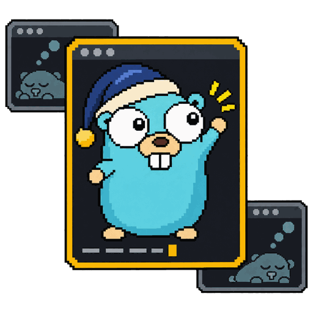

<p align="center">
  
</p>

# herdr-focus-resume

A [Herdr](https://herdr.dev) plugin that resumes agent panes when you focus them, instead of all at
once when the server starts.

After a server restart, Herdr resumes every agent pane it knows about (`claude --resume`,
`omp --resume`, `codex resume`, ...) as soon as a client attaches. With a dozen panes across
workspaces, that is a dozen agents booting together, each taking 400-800 MB of RAM, most of which
you will not open today. With this plugin only the focused pane resumes. The others stay as idle
shells (~7 MB each) until you select them.

## Install

Requires Herdr 0.9.2 or later and Go to build.

```bash
herdr plugin install crstian19/herdr-focus-resume
```

To pin a release, add `--ref vX.Y.Z` (see [releases](https://github.com/crstian19/herdr-focus-resume/releases)).

Turn off Herdr's own agent restore in `~/.config/herdr/config.toml`:

```toml
[session]
resume_agents_on_restore = false
```

Restart the Herdr server (`herdr server stop`, then `herdr`). Note that stopping the server ends
every process running in its panes.

## How it works

With `resume_agents_on_restore = false`, Herdr restores panes as plain shells but keeps each pane's
agent session reference in `session.json`.

- **Startup hook:** reads `session.json`, records every pane that had an agent, and resumes the
  pane that already has focus.
- **`pane.focused` hook:** when you select a recorded pane, checks that its shell is idle and its
  working directory has not changed, then types the resume command into it. Each pane is resumed
  once per server start.

The resume command is the one the agent reported to Herdr (`agent_resume`) or, for Herdr's built-in
integrations, the command from Herdr's documentation: `claude`, `codex`, `omp`, `pi`, `opencode`,
`kilo`, `kimi`, `grok`, `copilot`, `devin`, `droid`, `qwen`, `hermes` and `mastracode`. See
`internal/wake/resume.go`.

## Safety

- If `resume_agents_on_restore` is not `false`, the plugin does nothing, so an agent is never
  started twice. It logs that it is inactive at startup.
- If something other than the shell is running in a pane, the pane is left alone and dropped from
  the list.
- Focus events that arrive at the same time are serialised with a file lock.
- Resume commands are validated with Herdr's own rules (plain command name, no control characters)
  and shell-quoted before they are typed.

## Logs

Logs and per-session state are in Herdr's plugin state directory, usually
`~/.local/state/herdr/plugins/crstian19.focus-resume/`:

```text
startup: 10 dormant pane(s)
woke wE:p2B (claude) in /home/me/project
woke wE:p1V (omp) in /home/me/other
```

## Limitations

- Pane ids are derived from `session.json` (`public_pane_numbers`, encoded in Crockford base32).
  This is an internal Herdr format. If it changes, the working-directory check makes the plugin
  skip the pane rather than type into the wrong one, and the log shows the skipped panes.
- Tested on Linux with Herdr 0.9.5, Claude Code and omp. The other agents use the documented
  commands but have not been tested.
- The resume command shows up in the shell history of the pane.

## Development

```bash
go build -o bin/herdr-focus-resume .
herdr plugin link "$PWD"

go vet ./... && go test -race ./...
go test -run '^$' -fuzz FuzzShellQuoteRoundTrip -fuzztime 30s ./internal/wake
```

## License

MIT. The logo is based on the Go gopher by Renée French, licensed under
[CC BY 4.0](https://creativecommons.org/licenses/by/4.0/).
